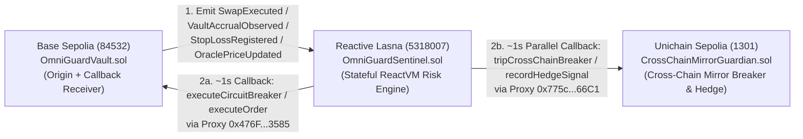

# OmniGuard — Sub-Second Cross-Chain Vault Circuit-Breaker & Keeper-Less Stop-Loss Sentinel

> **Reactive Omni Buildathon (Track 1: Every Second Counts)**  
> Built for **Base Sepolia (84532)** ↔ **Reactive Network Lasna (5318007)** ↔ **Unichain Sepolia (1301)**

## Why Every Second Counts

DeFi exploits and flash volatility unfold inside 1–3 blocks (~2–6 seconds). Traditional multisig pauses and off-chain keeper bots take minutes—by the time a human reacts, vaults and cross-chain sister pools are already drained.

**OmniGuard** uses **Reactive Omni's ~1-second CometBFT finality** to move continuous stateful risk monitoring and keeper-less stop-loss execution directly into a **Reactive Smart Contract (`OmniGuardSentinel`)** on Reactive Lasna:

1. **Multi-Step Slow-Bleed Slippage Sentinel**: Catches consecutive sub-threshold swaps (e.g., `3 × 1.90%` swaps that each bypass a local `2.00%` per-tx guard) using a stateful decaying accumulator inside ReactVM (`maxCumulativeSlippageBps = 500`, `decayWindow = 3600s`).
2. **Stale-Accrual & Utilization-Jump Detector**: Detects retroactive-interest / phantom-debt patterns (prolonged stale accrual window combined with `>= 90%` utilization) or single-block `>= 70%` utilization spikes.
3. **Keeper-Less Sub-Second Stop-Loss & Take-Profit Engine**: Tracks user orders inside ReactVM storage and evaluates `OraclePriceUpdated` ticks with zero off-chain keepers, triggering local settlement on Base Sepolia and a parallel cross-chain hedge signal on Unichain Sepolia.
4. **Dual-Chain Callback Fan-Out & On-Chain Latency Instrumentation**: Every breach or order trigger emits **two parallel `Callback` events** in the same `react()` transaction—freezing Base Sepolia (`OmniGuardVault`) and Unichain Sepolia (`CrossChainMirrorGuardian`) simultaneously—while recording exact `latencySeconds = callbackTimestamp - originTimestamp` on-chain (`getLatencyStats()`).

---

## Architecture



---

## Official Reactive Omni Testnet Infrastructure

| Network | Chain ID | Official Callback Proxy / System Contract | RPC Endpoint |
|---|---|---|---|
| **Base Sepolia** | `84532` | Callback Proxy: `0x476F44b11F5C942c58f4c8E3d0300E5710743585` | `https://sepolia.base.org` |
| **Unichain Sepolia** | `1301` | Callback Proxy: `0x775c9B990ADe401060B78D0e98684eEf8d2466C1` | `https://sepolia.unichain.org` |
| **Reactive Lasna** | `5318007` | System Contract: `0x0000000000000000000000000000000000fffFfF` | `https://lasna-rpc.rnk.dev/` |

---

## Deployed Contracts & End-to-End Verification Log

> Status: Local 3-chain Foundry unit + fuzz test suite **16/16 passing** (`10` end-to-end integration tests + `5 × 256`-run fuzz property tests + idempotency check, `0` warnings). Live testnet deployment pending free testnet gas funding (`Base Sepolia ETH` + `Unichain Sepolia ETH` + Lasna `lREACT` faucet `0x2afaFD298b23b62760711756088F75B7409f5967`).

| Component | Chain | Contract Address | Verification / E2E TX Hash |
|---|---|---|---|
| `OmniGuardVault` | Base Sepolia (`84532`) | _Pending live deploy_ | _Pending_ |
| `CrossChainMirrorGuardian` | Unichain Sepolia (`1301`) | _Pending live deploy_ | _Pending_ |
| `OmniGuardSentinel` | Reactive Lasna (`5318007`) | _Pending live deploy_ | _Pending_ |

---

## Quickstart & Local Verification

```bash
# 1. Run full 3-chain end-to-end Foundry test suite (10 tests)
forge test -vv

# 2. Deploy to Base Sepolia (84532)
export PRIVATE_KEY=0x...
forge script script/DeployBaseSepolia.s.sol:DeployBaseSepolia \
  --rpc-url https://sepolia.base.org --broadcast

# 3. Deploy to Unichain Sepolia (1301)
forge script script/DeployUnichainSepolia.s.sol:DeployUnichainSepolia \
  --rpc-url https://sepolia.unichain.org --broadcast

# 4. Deploy Reactive Sentinel on Reactive Lasna (5318007)
export BASE_SEPOLIA_VAULT=0x...
export UNICHAIN_SEPOLIA_MIRROR=0x...
forge script script/DeployReactiveLasna.s.sol:DeployReactiveLasna \
  --rpc-url https://lasna-rpc.rnk.dev/ --broadcast

# 5. Trigger Live Demo Loop & Measure Latency
forge script script/TriggerDemoLoop.s.sol:TriggerDemoLoop \
  --rpc-url https://sepolia.base.org --broadcast
```

Open [`dashboard/index.html`](dashboard/index.html) in any browser to inspect live on-chain latency statistics (`getLatencyStats()`) across Base Sepolia and Unichain Sepolia or run the interactive 3-chain simulation.

## License

MIT
