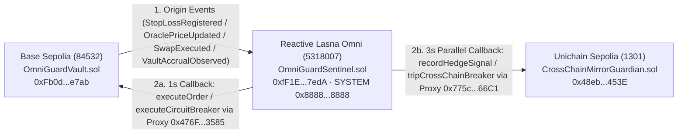

# OmniGuard — Sub-Second Cross-Chain Vault Circuit-Breaker & Keeper-Less Stop-Loss Sentinel

> **Reactive Omni Buildathon — Track 1: Every Second Counts**  
> Built natively on **`reactive-lib-omni`** (`SYSTEM = 0x8888888888888888888888888888888888888888`, `SYSTEM.requestCallbackV_1_0()`, `onlySystem`, `onlyServiceProvider`, `onlyCallbackSender`) across **Base Sepolia (`84532`)** ↔ **Reactive Lasna Omni (`5318007`)** ↔ **Unichain Sepolia (`1301`)**.

- **Live 3-Chain Telemetry Dashboard**: https://z121245017-ai.github.io/omniguard-reactive/
- **Measured Live End-to-End Latency (On-Chain `getLatencyStats()`)**:
  - **Base Sepolia (`84532`) Origin → Reactive Lasna Omni → Base Sepolia Callback**: **`1 second`** (`12:06:07Z → 12:06:08Z`)
  - **Base Sepolia (`84532`) Origin → Reactive Lasna Omni → Unichain Sepolia (`1301`) Parallel Cross-Chain Callback**: **`3 seconds`** (`12:06:07Z → 12:06:10Z`)

---

## Why Every Second Counts

DeFi exploits and flash crashes unfold inside 1–3 seconds. Traditional multisigs and off-chain keeper bots react minutes too late—after vaults and sister pools on other rollups are already drained.

**OmniGuard** moves continuous stateful risk monitoring and keeper-less stop-loss execution directly onto **Reactive Omni (`~1s` CometBFT finality)** via `OmniGuardSentinel`:

1. **Keeper-Less Sub-Second Stop-Loss & Cross-Chain Hedge Engine** *(Live verified on-chain)*: Tracks trader orders inside `OmniGuardSentinel` and evaluates `OraclePriceUpdated` ticks with zero off-chain keepers, triggering local settlement on **Base Sepolia (`1s`)** and a parallel cross-chain hedge signal on **Unichain Sepolia (`3s`)** in the same `react()` transaction.
2. **Multi-Step Slow-Bleed Slippage Sentinel**: Catches consecutive sub-threshold swaps (e.g., `3 × 1.90%` swaps bypassing a local `2.00%` per-tx guard) via a stateful time-decaying accumulator (`500 bps` cap, `3600s` timestamp decay window—using timestamps rather than block counts for Base Sepolia's `200ms` blocks).
3. **Stale-Accrual & Utilization-Jump Detector**: Flags retroactive-interest patterns (`staleSeconds >= 24h` + `utilization >= 90%`) or `>= 70%` single-step utilization spikes.
4. **Native Reactive Omni Security & Gas-Packed Storage**: Uses `reactive-lib-omni` (`onlySystem`, immutable `_CALLBACK_SENDER` pre-computed deterministically via CREATE nonce, `onlyServiceProvider` + `onlyCallbackSender`, incident replay protection, and 1-slot packed `uint64 × 4` latency instrumentation).

---

## Live Deployed Contracts & Verified End-to-End TX Loop

### 1. Deployed Contracts (All Live & Verified)

| Component | Chain | Contract Address | Deploy TX & Block |
|---|---|---|---|
| **`OmniGuardVault`** | Base Sepolia (`84532`) | [`0xFb0dF9C593dF951B75d35ea3Caf6a75fA689e7ab`](https://base-sepolia.blockscout.com/address/0xFb0dF9C593dF951B75d35ea3Caf6a75fA689e7ab) | [`0x8c6c7739...127a9a`](https://base-sepolia.blockscout.com/tx/0x8c6c77390c0656212ac7b325d962e7bc57ea45afe55ae29a88c816bbf9127a9a) (`#63863013`) |
| **`OmniGuardSentinel`** | Reactive Lasna Omni (`5318007`) | [`0xfF1E8e50C8895897C00a0c801E73abE2F1337edA`](https://lasna.reactscan.net/address/0xfF1E8e50C8895897C00a0c801E73abE2F1337edA) | [`0x60b8c6b0...c97961`](https://lasna.reactscan.net/tx/0x60b8c6b04fb7a66804a8d32348e5e3b078633704ca66a98d78587b0a68c97961) (`#9295439`) |
| **`CrossChainMirrorGuardian`** | Unichain Sepolia (`1301`) | [`0x48eba200ACC1C45bC83eF9a5c1445d690470453E`](https://unichain-sepolia.blockscout.com/address/0x48eba200ACC1C45bC83eF9a5c1445d690470453E) | [`0x052eeca0...66d402`](https://unichain-sepolia.blockscout.com/tx/0x052eeca0dcd99c8ef50a7f3995de0e7f5e7536791df1a8a89943c8fb9666d402) (`#68842060`) |

### 2. Full End-to-End Reactive Loop Proof (`Origin → Lasna Omni → Dual Callbacks`)

| Step | Chain | Event / Method | Verified TX Hash | Result / Latency |
|---|---|---|---|---|
| **1. Origin Register** | Base Sepolia (`84532`) | `registerOrder(10 ETH, $3,000 SL)` | [`0xc661daf5...7a3fe5e`](https://base-sepolia.blockscout.com/tx/0xc661daf57fe559f7199be8391a7be3286da09f723e38d85aacfdcd9b27a3fe5e) | Order #1 emitted (`#63864488`) |
| **2. Reactive Ingest** | Reactive Lasna (`5318007`) | `react(StopLossRegistered)` | [`0xe732d12b...d4a701`](https://lasna.reactscan.net/tx/0xe732d12bf7e6a3367d0560f23187fa24e4bdac2563f72796f7ee3740d0d4a701) | Indexed Order #1 (`#9295466`) |
| **3. Origin Trigger** | Base Sepolia (`84532`) | `publishPriceTick(WETH, $2,950)` | [`0xfec6f0f5...bb0298`](https://base-sepolia.blockscout.com/tx/0xfec6f0f5f8452e4aad1675b4a93eba50e7dc764fa4f336bce28fdc3042bb0298) | Crash tick emitted (`#63864495`) |
| **4. Reactive Fan-Out** | Reactive Lasna (`5318007`) | `react(OraclePriceUpdated)` → `requestCallbackV_1_0` ×2 | [`0xd0904a2f...ea4518`](https://lasna.reactscan.net/tx/0xd0904a2f2a5246a91d4cde253dde65172b4365dbf14c8e74ff4a9c6905ea4518) | Matched #1, fanned out to Base & Unichain (`#9295467`) |
| **5a. Base Callback** | Base Sepolia (`84532`) | `executeOrder()` via Proxy `0x476F...3585` | [`0xef5f95bd...2d8996`](https://base-sepolia.blockscout.com/tx/0xef5f95bd994e71fc1b4a312562f2cfd654c4754c9768f8567bc6c8bc1a2d8996) | **`status: ok` · `1s` on-chain latency** (`#63864500`) |
| **5b. Unichain Callback** | Unichain Sepolia (`1301`) | `recordHedgeSignal()` via Proxy `0x775c...66C1` | [`0x7f02b84f...85ccfa`](https://unichain-sepolia.blockscout.com/tx/0x7f02b84fe6cafcd321ae3aa11def922c172e47ab998b1f24941ef0ce7185ccfa) | **`status: ok` · `3s` cross-chain latency** (`#68842342`, `hedges=1`) |

---

## Architecture



---

## Verification & Quickstart

```bash
# Run full 3-chain Foundry unit + 256-run fuzz suite (15/15 passing, Solc 0.8.29, 0 warnings)
forge test -vv
```

Open [`dashboard/index.html`](dashboard/index.html) or visit https://z121245017-ai.github.io/omniguard-reactive/ to poll live on-chain `getLatencyStats()` across Base Sepolia, Reactive Lasna Omni, and Unichain Sepolia.

## License

MIT
